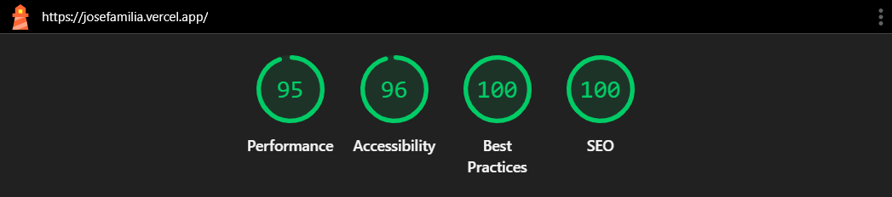

# Portfolio 2026

Portfolio profesional minimalista construido con Astro, Keystatic y TailwindCSS.

## 🚀 Características

- **Astro** - Framework de última generación para sitios web de contenido
- **Keystatic CMS** - Gestión de contenido sin código, con interfaz amigable
- **TailwindCSS** - Estilos utilitarios para diseño rápido y consistente
- **Motion** - Animaciones sutiles y performantes
- **TypeScript** - Tipado estático para código más seguro
- **SEO optimizado** - Meta tags, Open Graph, JSON-LD
- **Modo oscuro** - Soporte completo para tema claro/oscuro
- **Accesible** - Siguiendo las mejores prácticas de a11y

### 🤖✅ Optimizacion



## 📁 Estructura del Proyecto

```
/
├── public/                 # Assets estáticos
│   ├── favicon.svg
│   └── images/
├── src/
│   ├── components/         # Componentes reutilizables
│   │   ├── blog/          # Componentes del blog
│   │   ├── home/          # Componentes de la home
│   │   ├── layout/        # Header, Footer
│   │   ├── motion/        # Componentes de animación (React)
│   │   ├── projects/      # Componentes de proyectos
│   │   └── ui/            # Componentes UI base
│   ├── content/           # Contenido gestionado por Keystatic
│   │   ├── blog/          # Artículos del blog
│   │   ├── pages/         # Contenido de páginas
│   │   ├── projects/      # Proyectos
│   │   └── settings/      # Configuración del sitio
│   ├── layouts/           # Layouts de página
│   │   ├── BaseLayout.astro
│   │   ├── BlogPostLayout.astro
│   │   └── ProjectLayout.astro
│   ├── pages/             # Rutas/páginas
│   │   ├── api/           # API routes (Keystatic)
│   │   ├── blog/
│   │   ├── keystatic/     # Panel de admin
│   │   └── proyectos/
│   ├── styles/            # Estilos globales
│   │   └── global.css
│   └── utils/             # Utilidades y helpers
├── astro.config.mjs       # Configuración de Astro
├── keystatic.config.tsx   # Configuración de Keystatic CMS
├── tailwind.config.mjs    # Configuración de Tailwind
└── tsconfig.json          # Configuración de TypeScript
```

## 🛠️ Instalación

```bash
# Clonar el repositorio
git clone https://github.com/Jose-Familia/Portfolio2026-Astro.git

# Entrar al directorio
cd Portfolio2026-Astro

# Instalar dependencias
npm ci

# Iniciar servidor de desarrollo
npm run dev
```

## 📝 Gestión de Contenido

El proyecto usa **Keystatic** para gestionar el contenido. Para acceder al panel de administración:

1. Inicia el servidor de desarrollo: `npm run dev`
2. Visita `http://localhost:4321/keystatic`
3. Edita el contenido desde la interfaz visual

### Tipos de contenido

- **Páginas**: Home, Sobre mí (singletons)
- **Proyectos**: Colección de proyectos con imágenes, tecnologías y enlaces
- **Blog**: Artículos con categorías, tags y contenido MDX
- **Configuración**: Datos del sitio, SEO y redes sociales

## 🎨 Personalización

### Colores

Edita los colores en `tailwind.config.mjs`:

```js
colors: {
  primary: {
    500: '#0ea5e9', // Color principal
    // ...
  },
}
```

### Tipografía

Las fuentes se cargan desde Google Fonts en `BaseLayout.astro`. Puedes cambiar Inter y JetBrains Mono por otras fuentes.

### Animaciones

Las animaciones CSS están definidas en `tailwind.config.mjs` y los componentes de Motion en `src/scripts/site.ts`.

## 📦 Scripts

| Comando           | Descripción              |
| ----------------- | ------------------------ |
| `npm run dev`     | Servidor de desarrollo   |
| `npm run build`   | Compilar para producción |
| `npm run preview` | Preview del build        |
| `npm run astro`   | CLI de Astro             |

## 🚀 Despliegue

### Vercel (Recomendado)

1. Conecta tu repositorio de GitHub
2. Vercel detectará automáticamente que es un proyecto Astro
3. Configura las variables de entorno si usas Keystatic con GitHub

### Otras plataformas

Astro soporta múltiples adaptadores: Netlify, Cloudflare, Node.js, etc.

## 📄 Licencia

MIT License - Siéntete libre de usar este proyecto como base para tu portfolio.

---

Hecho con ❤️ usando [Astro](https://astro.build)

# Portfolio2026-Astro

## Actualización del portafolio

La colección `src/content/projects/` presenta **Nexo TI**, **DigitalWave** y este portafolio. El proyecto anterior de tickets y sus capturas se retiraron del sitio; su repositorio de GitHub permanece intacto. Las capturas de Nexo TI proceden de `Jose-Familia/Nexo_TI/docs/` y muestran datos de demostración.

- Edita las fichas `.mdoc` o usa Keystatic para mantener descripciones, enlaces, tecnologías y categorías. La selección refleja los repositorios revisados el 20 de noviembre de 2026; no consulta GitHub desde el navegador ni se sincroniza automáticamente.
- La búsqueda combina todos los términos con una categoría exacta, ignora acentos y conserva `q` y `tag` en la URL. El botón de restablecer permite volver al catálogo completo.
- La galería utiliza un diálogo nativo: botones anterior/siguiente, teclas izquierda/derecha, Escape y retorno del foco al disparador.
- El tema se aplica antes de pintar la página, se conserva al navegar y tolera el almacenamiento bloqueado. Los efectos de entrada usan un observador compartido y Web Animations, con limpieza al navegar y respeto por movimiento reducido.
- El formulario comparte un controlador ES/EN que evita envíos duplicados. Requiere `RESEND_API_KEY` en Vercel y un remitente habilitado en Resend. Sin esa variable devuelve 503 con un correo de contacto. Las pruebas simulan el proveedor; no envían correos reales.

El perfil traducido se mantiene en `src/i18n/about.ts`; la portada en `src/pages/index.astro`. Los campos YAML de perfil y portada también se actualizan como contenido del CMS; esas vistas todavía usan sus datos propios. No se añadieron como obtenidas certificaciones que están en preparación.

```bash
npm test
npm run build
```

## Formación, habilidades y artículos

El perfil prioriza Ingeniería en Sistemas, desarrollo de aplicaciones e interés en cloud y TI. La experiencia laboral tiene una sección visible entre formación y habilidades, con empresa, cargo, fechas y responsabilidades. Educación y experiencia comparten `ProfileTimeline.astro`, con el mismo formato de línea de tiempo en español e inglés. Las dos versiones también comparten `SkillsSection.astro` y `Certifications.astro`.

- `src/data/skills.ts` organiza los badges por área con claves de icono explícitas; `src/utils/techLogos.ts` resuelve sus insignias. Los SVG adicionales de Devicon se sirven localmente con su atribución y licencia MIT en `public/icons/tech/`.
- Se muestran tres credenciales seleccionadas por su relación con desarrollo y datos: SQL Associate (DataCamp), Oracle Next Education: Frontend y Diseño Web Responsivo (freeCodeCamp). Conservan su fecha, institución, tipo, habilidades e identificador cuando está disponible. Los filtros solo muestran categorías con credenciales.
- Se añadieron seis artículos con ejemplos de estudio, referencias oficiales y portadas SVG. Sus fechas anteriores y variadas se eligieron a petición del autor; no representan fechas de implementación ni experiencias de trabajo. Los temas son Astro/React, NestJS, PostgreSQL, Docker, Kubernetes y AWS SQS.
- Los artículos relacionados se seleccionan por categoría, etiquetas y fecha. El tiempo de lectura se mantiene consistente entre listados y fichas mediante `src/utils/readingTime.ts`, respetando los valores editoriales definidos en el contenido.

## Temas y contraste

La paleta semántica vive en `src/styles/global.css` y se utiliza mediante colores de Tailwind como `canvas`, `surface`, `ink`, `muted-ink` y `line`. Los textos principales, secundarios y de acento se comprueban contra las tres superficies de ambos temas con un contraste mínimo de 4.5:1.

`src/scripts/theme.ts` gestiona selección explícita, preferencia del sistema, almacenamiento bloqueado, sincronización entre pestañas y los eventos de navegación de Astro. La selección se aplica antes del primer pintado y antes de intercambiar la página; también actualiza `color-scheme`, el color del navegador y la etiqueta del control. Los iconos con variantes siguen la clase del tema, en lugar de depender solo de la preferencia del sistema. Las marcas monocromas utilizan una base de contraste; las demás conservan sus colores.

## Dirección visual editorial

La actualización visual toma como referencia la composición editorial de cristianbaeza.com: titulares serif, etiquetas monoespaciadas, portada en dos columnas y separadores finos. Conserva el acento azul, los dos temas, el contenido propio y todas las funciones existentes. `src/styles/editorial.css` contiene esta capa visual; Instrument Serif se sirve localmente mediante `@fontsource/instrument-serif` con variantes normal e itálica.

La portada presenta las áreas de aprendizaje, accesos con cantidades derivadas de las colecciones, proyectos seleccionados y artículos recientes con sus banners. Educación y experiencia mantienen su componente de línea de tiempo compartido; las tres credenciales seleccionadas y las insignias de habilidades siguen disponibles en ambos idiomas.
